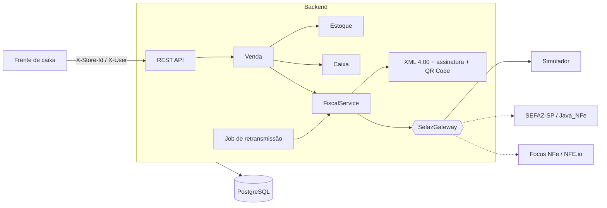
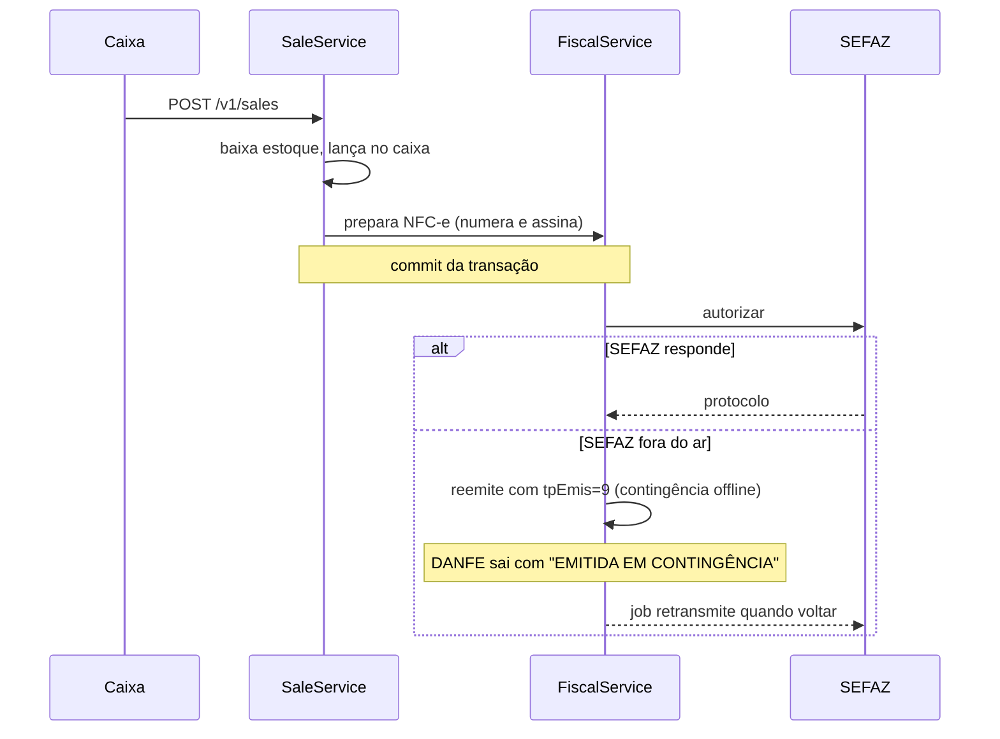

# PDV com Controle de Caixa e NFC-e

[](https://github.com/efvieira/pos-fiscal-nfce/actions/workflows/ci.yml)
[](https://github.com/efvieira/pos-fiscal-nfce/actions/workflows/cd.yml)


[](LICENSE)

Backend de **ponto de venda (PDV)** para pequeno comércio: abertura e fechamento de caixa, sangria e suprimento, vendas em dinheiro, cartão e Pix, baixa automática de estoque e **emissão de NFC-e** com XML assinado, QR Code, DANFE em PDF e **contingência offline**.

Tudo segue a documentação pública da SEFAZ (Manual de Orientação do Contribuinte e Notas Técnicas da NFC-e). O escopo inicial é **São Paulo** e emitente do **Simples Nacional**.

### ✨ Destaques

- 💵 **Caixa completo**: abertura com fundo de troco, sangria, suprimento e fechamento com conferência **esperado x contado** por meio de pagamento
- 🧾 **NFC-e modelo 65**: chave de acesso com DV módulo 11, XML 4.00, assinatura XMLDSig, QR Code v2 e DANFE de 80 mm
- 📴 **Contingência offline**: se a SEFAZ cai, a venda continua; a nota é reemitida com `tpEmis=9` e transmitida depois por um job
- 🔌 **Autorizador plugável**: a SEFAZ fica atrás da interface `SefazGateway`, que permite trocar o simulador por SEFAZ-SP direta ou por um provedor (Focus NFe, NFE.io) sem mexer no domínio
- 🏬 **Multi-loja**: cada requisição carrega a loja e só enxerga os próprios dados (contexto em `ScopedValue` do Java 25)
- 🕵️ **Auditoria** de cada operação: quem fez, o quê e quando
- 📊 **Relatórios**: vendas por período, por meio de pagamento e por dia, fechamentos de caixa e notas pendentes

### 🛠️ Stack

Java 25 · Spring Boot 4.1 · Spring Data JPA · Flyway · PostgreSQL · XMLDSig (JDK) · OpenPDF · ZXing · springdoc-openapi · JUnit 5 · JaCoCo · Docker · GitHub Actions

## 🏗️ Arquitetura



### Emissão com contingência



## 🧠 Decisões técnicas

| Decisão | Por quê |
|---|---|
| Transmitir à SEFAZ **depois** do commit da venda | A SEFAZ pode levar segundos. Fazer a chamada dentro da transação seguraria o lock de estoque e de numeração de todas as vendas da loja. |
| Numeração com `SELECT ... FOR UPDATE` na loja | Duas vendas simultâneas nunca recebem o mesmo número de NFC-e (a SEFAZ rejeitaria a duplicidade). |
| Interface `SefazGateway` com resultado *sealed* | O domínio não depende de SOAP nem de fornecedor. Trocar o autorizador significa só trocar o bean. |
| Contingência gera **nova chave** | O `tpEmis` faz parte da chave de acesso, então a nota em contingência é outro documento com a mesma numeração. |
| QR Code offline usa o `DigestValue` | É o que permite ao consumidor validar uma nota que ainda não chegou à SEFAZ. |
| Dados fiscais copiados para o item da venda | Se o NCM ou o preço do produto mudar depois, a venda (e o XML) continua refletindo o momento da emissão. |
| `ScopedValue` em vez de `ThreadLocal` | É imutável, encerra sozinho no fim da requisição e não vaza entre virtual threads. |
| Certificado A1 só por variável de ambiente | Certificado e senha nunca entram no repositório (`*.pfx` e `*.p12` estão no `.gitignore`). |

## 🚀 Como rodar

```bash
docker compose up -d --build
```

Swagger: http://localhost:8080/swagger-ui.html. A migração já cria a loja **Padaria Demo** (`00000000-0000-0000-0000-000000000001`) com 4 produtos.

```bash
H='-H X-Store-Id:00000000-0000-0000-0000-000000000001 -H X-User:ana -H Content-Type:application/json'

# Abrir o caixa
curl -s $H -X POST localhost:8080/v1/cash-sessions -d '{"openingFloat": 100}'

# Vender 2 cafés pagando em dinheiro (com troco)
curl -s $H -X POST localhost:8080/v1/sales -d '{
  "items": [{"productId": "10000000-0000-0000-0000-000000000002", "quantity": 2}],
  "payments": {"CASH": 20}}'

# DANFE em PDF
curl -s $H localhost:8080/v1/sales/<id>/nfce/danfe -o danfe.pdf

# Derrubar a SEFAZ simulada e vender em contingência
curl -s -X POST 'localhost:8080/v1/admin/sandbox/sefaz?online=false'

# Fechar o caixa informando o que foi contado
curl -s $H -X POST localhost:8080/v1/cash-sessions/current/close -d '{"counted": {"CASH": 113}}'
```

### Testes

```bash
./mvnw verify
```

## 📡 Endpoints principais

| Método | Rota | Descrição |
|---|---|---|
| `POST` | `/v1/cash-sessions` | Abre o caixa do operador |
| `POST` | `/v1/cash-sessions/current/supplies` | Suprimento |
| `POST` | `/v1/cash-sessions/current/withdrawals` | Sangria |
| `POST` | `/v1/cash-sessions/current/close` | Fechamento com conferência |
| `GET/POST/PUT` | `/v1/products` | Produtos com NCM, CFOP e CSOSN |
| `POST` | `/v1/products/{id}/stock-adjustments` | Ajuste de estoque com motivo |
| `POST` | `/v1/sales` | Venda + emissão da NFC-e |
| `POST` | `/v1/sales/{id}/cancel` | Cancelamento (prazo de 30 min, justificativa ≥ 15 caracteres) |
| `GET` | `/v1/sales/{id}/nfce/xml` | XML assinado |
| `GET` | `/v1/sales/{id}/nfce/danfe` | DANFE em PDF |
| `GET` | `/v1/reports/sales` | Vendas por período, meio de pagamento e dia |
| `GET` | `/v1/reports/cash-closings` | Fechamentos de caixa |
| `GET` | `/v1/reports/fiscal-pending` | Notas em contingência aguardando envio |
| `GET` | `/v1/audit` | Trilha de auditoria da loja |

## ⚠️ Escopo e limites

- O autorizador padrão é o **simulador**. Para homologação real na SEFAZ-SP, implemente `SefazGateway` com a biblioteca [Java_NFe](https://github.com/Samuel-Oliveira/Java_NFe) e configure `FISCAL_CERT_PATH`/`FISCAL_CERT_PASSWORD` com um certificado A1.
- Tributação implementada: Simples Nacional (CSOSN), sem destaque de ICMS. Regime normal (CST) e NF-e modelo 55 estão nos próximos passos.

## 🗺️ Próximos passos

- [ ] Adaptador real para SEFAZ-SP em homologação
- [ ] NF-e modelo 55 e inutilização de numeração
- [ ] Frente de caixa em Angular
- [ ] Recebimento Pix integrado ao [pix-payment-gateway](https://github.com/efvieira/pix-payment-gateway)
- [ ] Login via [auth-service](https://github.com/efvieira/auth-service)

## 🔀 Fluxo de branches e CI/CD

`develop` (padrão) → `release` → `master`, sempre por PR. Detalhes em [CONTRIBUTING.md](CONTRIBUTING.md).

## 📄 Licença

[MIT](LICENSE)
